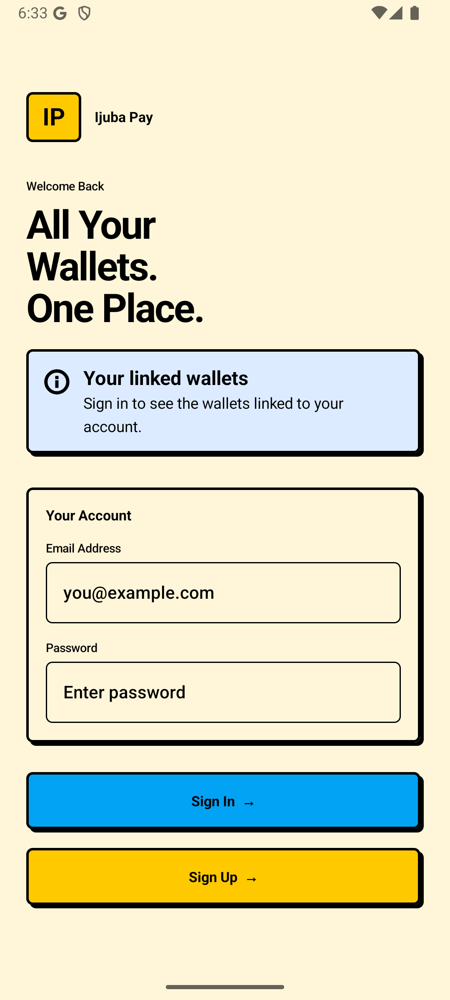
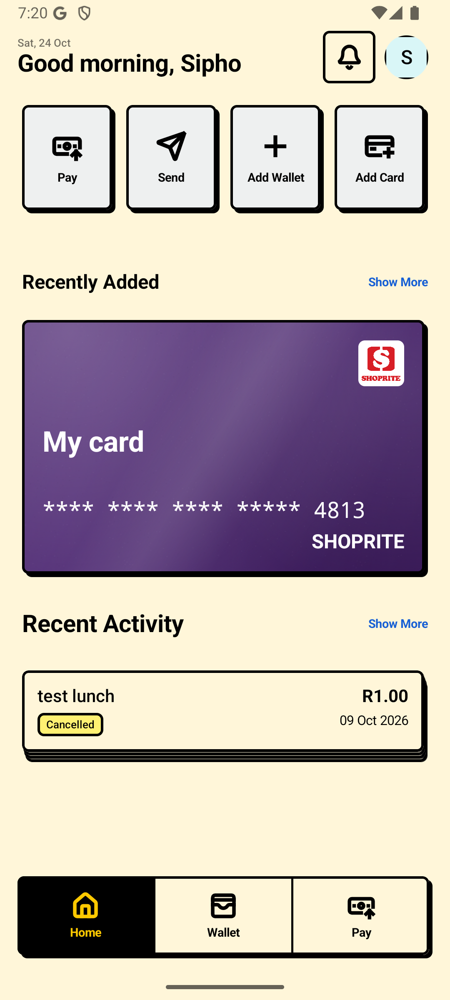
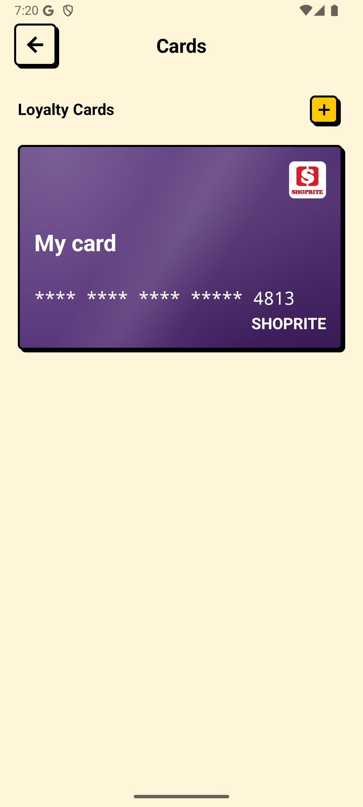
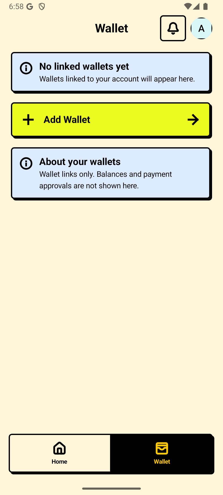

<p align="center">
  
</p>

<h1 align="center">IjubaPay</h1>
<p align="center"><strong>Your wallets and loyalty cards, together.</strong></p>
<p align="center">An Android wallet by Ijuba Labs, built around Open Payments.</p>

<p align="center">
  <a href="https://github.com/Ijuba-Labs/ijuba-wallet/releases/download/v1.0.0-preview.1/IjubaPay.apk"></a>
  <a href="https://github.com/Ijuba-Labs/ijuba-wallet/releases"></a>
</p>

> **This is a testnet preview.** Use test accounts and test wallets. The backend
> runs during arranged testing sessions, so signing in and online actions are
> unavailable while it is stopped. Merchant checkout has not been activated.
> This preview is not a production payment service.

## A look inside

<p align="center">
  
  
  
  
</p>

Screenshots show the sign-in screen and authenticated UI during QA with a
testing account on a local backend. The downloadable APK connects to the
deployed AWS endpoints listed below. QA screenshots do not establish production
payment readiness.
Private card-entry and barcode screens retain their screenshot protections.

## What you can explore

| Feature | In this preview |
| --- | --- |
| Your account | Create an account, sign in with email/password, and securely store the session on your device. |
| Linked wallets | Link an Open Payments test wallet through its provider's browser approval flow. |
| Loyalty cards | Save membership details and observed barcodes, choose card colours, and manage your collection. |
| Scan and upload | Recognize supported barcodes or suggest membership numbers from card images; review before saving. |
| Send | Explore the existing testnet transfer interface with provider-controlled consent. Funded transfers are not part of release verification. |
| Merchant Pay | Interface included; server activation and payment compatibility validation are deferred. |

Retailer acceptance is not verified by this preview. Saving a card or barcode
does not establish that a retailer will accept it. Some notifications are
labeled examples; phone and Google registration are marked coming soon.

## Download and install

1. On an Android phone running **Android 7.0 or newer**, download
   [**IjubaPay.apk**](https://github.com/Ijuba-Labs/ijuba-wallet/releases/download/v1.0.0-preview.1/IjubaPay.apk).
2. Open the downloaded file. If Android asks, allow that browser or file manager
   to install apps from this source, then follow the installation prompts.
3. Open **IjubaPay** and create your own test account while the backend is online.
4. After installation, you can turn that installation permission off again.

You do not need Android Studio. Google Play services are required for the native
barcode scanner. This download is an APK, not a Play Store listing.

If the download is blocked or unavailable, open the
[release page](https://github.com/Ijuba-Labs/ijuba-wallet/releases/tag/v1.0.0-preview.1)
and expand **Assets**. Download the `.apk`, not GitHub's automatic showcase
source archives.

### Verify the download

Every release includes `IjubaPay.apk.sha256` and `release-info.json` with the
version, APK hash, and signing-certificate fingerprint. On macOS or Linux:

```sh
shasum -a 256 -c IjubaPay.apk.sha256
```

For updates, download a newer APK from this repository and install it over the
existing release. Release builds use application ID `com.ijubalabs.ijubapay`;
development builds are separate. Keep the installed app when updating if you
want to retain its local settings and account session.

## Availability and feedback

This preview uses a credit-funded test backend at `ijuba-wallet.duckdns.org`
and `ijuba-checkout.duckdns.org`. Availability is session-based. If the service
is offline, wait for an arranged testing session and retry; reinstalling the
app does not start the backend.

Found a problem? [Open an issue](https://github.com/Ijuba-Labs/ijuba-wallet/issues/new/choose)
with the app version, Android version, reproduction steps, and any redacted
screenshots. Never share passwords, access tokens, private keys, or complete
loyalty numbers in an issue.

## About this repository

This is the public presentation and APK distribution repository for IjubaPay.
The Android application source is private. GitHub's source ZIP/TAR downloads
contain this showcase, not the Android project.

IjubaPay is developed by [Ijuba Labs](https://github.com/Ijuba-Labs).
The public [Digital Wallet Backend](https://github.com/Ijuba-Labs/digital-wallet-backend)
provides wallet accounts and Open Payments integration. See
[third-party notices](THIRD_PARTY_NOTICES.md) for included acknowledgements.
